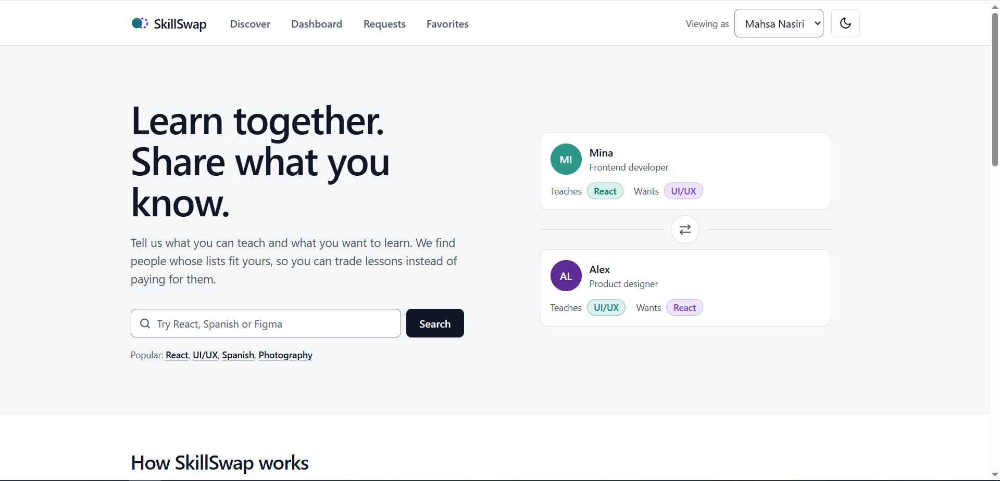

# SkillSwap

> Learn together. Share what you know.

SkillSwap is a peer-to-peer skill exchange platform that helps people discover compatible learning partners and exchange knowledge without paying for lessons.

**[Live Demo](https://mahsanasiry.github.io/skillswap/)** · **[GitHub Repository](https://github.com/mahsanasiry/skillswap)** · **[Portfolio](https://mahsanasiry.github.io/)**

## Overview

SkillSwap helps users discover people with complementary skills, evaluate potential matches, and manage skill-exchange requests through a responsive interface.

Built as a front-end portfolio project, it demonstrates type-safe development, client-side data fetching, form validation, reusable components, accessibility, automated testing, and static deployment.

## Screenshots

### Home Page





## Features

- **Skill discovery:** Search, filter, sort, and paginate users by skill, level, category, and availability.
- **Match scoring:** Calculate skill-based compatibility scores from 0 to 100.
- **Mutual matching:** Identify users with compatible teaching and learning interests.
- **User profiles:** Explore skills, proficiency levels, and availability.
- **Skill-swap requests:** Create validated requests and manage sent, received, and accepted requests.
- **Favorites:** Save users for quick access.
- **Personal dashboard:** View statistics and recent activity.
- **Demo user switching:** Explore different perspectives in the skill-exchange workflow.
- **Dark mode:** Switch themes with a persisted preference.
- **UI states:** Loading, empty, and error states with appropriate user feedback.
- **Responsive interface:** Support different screen sizes with accessibility in mind.

## Tech Stack

| Category                  | Technologies                            |
| ------------------------- | --------------------------------------- |
| Framework                 | Next.js 16, React 19                    |
| Language                  | TypeScript                              |
| Styling                   | Tailwind CSS 4                          |
| Data fetching and caching | TanStack Query                          |
| Forms and validation      | React Hook Form, Zod                    |
| Mock API                  | Mock Service Worker (MSW)               |
| Testing                   | Vitest, React Testing Library, axe-core |
| Code quality              | ESLint, TypeScript                      |
| CI/CD and deployment      | GitHub Actions, GitHub Pages            |

## Architecture

SkillSwap uses a mock REST API powered by Mock Service Worker (MSW), allowing the front end to interact with API-style endpoints without requiring a production backend.

The codebase separates UI components, hooks, data access, and shared types to support maintainability and future extension.

### Demo Limitations

- There is no production backend or real authentication service.
- Demo user switching simulates different user sessions.
- Application data is persisted locally in the browser where implemented.
- The demo showcases front-end functionality and is not intended to provide production account security.

## Getting Started

### Prerequisites

- Node.js 20 or later
- npm

### Installation

Clone the repository and install its dependencies:

```bash
git clone https://github.com/mahsanasiry/skillswap.git
cd skillswap
npm install
```

### Development Server

Start the local development server:

```bash
npm run dev
```

Open [http://localhost:3000](http://localhost:3000) in your browser.

### Production Build

Create an optimized production build:

```bash
npm run build
```

### GitHub Pages Build

Generate the project build intended for GitHub Pages:

```bash
npm run build:pages
```

## Testing

SkillSwap uses Vitest and React Testing Library for automated testing, with axe-core for accessibility checks.

The test suite covers areas including:

- Search and filtering
- Skill matching
- Request creation and status changes
- Favorites
- Dashboard behavior
- Form validation
- Error handling and rollback behavior
- Broken-link checks
- Accessibility checks
- Color-contrast checks

Run the test suite:

```bash
npm test
```

Run the tests in watch mode during development:

```bash
npm run test:watch
```

### Code Quality and Verification

Run the complete verification pipeline:

```bash
npm run verify
```

This command runs the following checks in sequence:

1. ESLint
2. TypeScript type checking
3. Automated tests
4. Production build

## Accessibility

Accessibility considerations include:

- Semantic HTML
- Keyboard navigation
- Visible focus states
- Labelled form controls
- Skip navigation
- Screen-reader announcements
- Automated accessibility checks
- Color-contrast checks

## Project Highlights

- Type-safe development with TypeScript
- Client-side data fetching and caching
- Schema-based form validation
- Reusable components and custom hooks
- Automated testing and code-quality checks
- Responsive and accessible UI development
- Mock API integration
- CI/CD workflows and static deployment

## Links

- **Live Demo:** [https://mahsanasiry.github.io/skillswap/](https://mahsanasiry.github.io/skillswap/)
- **GitHub Repository:** [https://github.com/mahsanasiry/skillswap](https://github.com/mahsanasiry/skillswap)
- **Portfolio:** [https://mahsanasiry.github.io/](https://mahsanasiry.github.io/)
